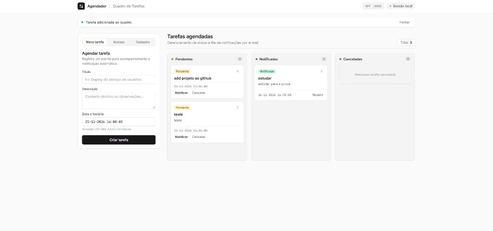
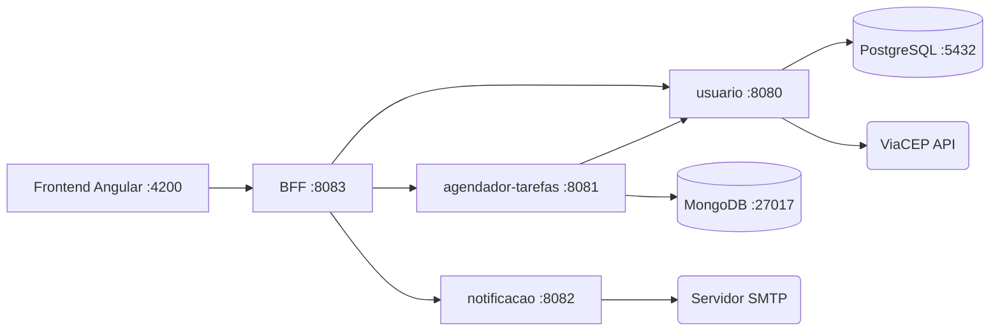

# Agendador de Tarefas

Sistema distribuído para agendamento de tarefas e envio automático de lembretes por e-mail. O projeto utiliza uma arquitetura de microsserviços em Java 17 com Spring Boot 3, persistência em PostgreSQL e MongoDB, um camada BFF (Backend for Frontend) e interface web em Angular 19.



## Arquitetura

O frontend comunica-se exclusivamente com o BFF (`:8083`), que orquestra as chamadas síncronas via OpenFeign para os serviços internos e executa uma rotina agendada (`@Scheduled`) a cada minuto para identificar tarefas próximas do horário e acionar o disparo de e-mails.



### Serviços

| Serviço | Porta | Descrição | Stack principal |
| :--- | :--- | :--- | :--- |
| `usuario` | `8080` | Cadastro, autenticação JWT, endereços, telefones e consulta ViaCEP | Spring Boot, Spring Security, Data JPA, PostgreSQL, OpenFeign |
| `agendador-tarefas` | `8081` | Criação, consulta por período/usuário e atualização de status de tarefas | Spring Boot, Data MongoDB, MapStruct, JWT |
| `notificacao` | `8082` | Disparo de e-mails transacionais de notificação | Spring Boot, JavaMailSender, Thymeleaf |
| `bff-agendador-tarefas` | `8083` | Gateway para o frontend, documentação OpenAPI e agendador de notificações | Spring Boot, OpenFeign (OkHttp), Spring Validation, Springdoc OpenAPI |
| `frontend-agendador-angular` | `4200` | Interface web com quadro Kanban, autenticação e cadastro | Angular 19 (Standalone Components), TypeScript |

## Execução com Docker

Todos os serviços possuem `Dockerfile` multi-stage. Não é necessário ter Java, Gradle ou Node.js instalados localmente para subir o ambiente via container.

```bash
git clone https://github.com/SEU_USUARIO/agendador-de-tarefas.git
cd agendador-de-tarefas
docker compose up -d --build
```

Endereços locais após a inicialização:

- **Frontend (Kanban):** `http://localhost:4200`
- **Swagger UI (BFF):** `http://localhost:8083/swagger-ui.html`
- **Swagger UI (Usuários):** `http://localhost:8080/swagger-ui.html`

## Execução em Ambiente de Desenvolvimento

Caso prefira rodar os serviços fora do Docker, inicie instâncias locais do PostgreSQL (`5432`, banco `db_usuario`) e do MongoDB (`27017`, banco `db_agendador`).

**Microsserviços Java:**
```bash
# Execute em cada diretório: usuario, agendador-tarefas, notificacao e bff-agendador-tarefas
./gradlew bootRun
```

**Frontend Angular:**
```bash
cd frontend-agendador-angular
npm install
npm start
```

## Variáveis de Ambiente

Os serviços já possuem valores padrão configurados para execução local. Para personalizar credenciais ou integração SMTP no Docker Compose:

| Variável | Serviço | Padrão local | Finalidade |
| :--- | :--- | :--- | :--- |
| `SPRING_DATASOURCE_URL` | `usuario` | `jdbc:postgresql://localhost:5432/db_usuario` | Conexão com o PostgreSQL |
| `SPRING_DATA_MONGODB_URI` | `agendador-tarefas` | `mongodb://localhost:27017/db_agendador` | Conexão com o MongoDB |
| `JWT_SECRET` | `usuario`, `agendador-tarefas` | *(chave de desenvolvimento)* | Segredo de assinatura e validação do token JWT |
| `EMAIL_USERNAME` | `notificacao` | `seu_email@gmail.com` | Conta SMTP utilizada para envio |
| `EMAIL_PASSWORD` | `notificacao` | `sua_senha_app` | Senha de aplicativo da conta SMTP |
| `CRON_EMAIL` / `CRON_SENHA` | `bff-agendador-tarefas` | `admin@agendador.com` / `123456` | Credenciais utilizadas pela rotina `@Scheduled` |

## Endpoints Principais (BFF `:8083`)

| Método | Rota | Autenticação | Descrição |
| :--- | :--- | :--- | :--- |
| `POST` | `/usuario` | Pública | Cadastra um novo usuário com endereços e telefones |
| `POST` | `/usuario/login` | Pública | Autentica o usuário e retorna o token `Bearer` |
| `GET` | `/usuario/endereco/{cep}` | Pública | Consulta dados de logradouro no ViaCEP |
| `GET` | `/usuario?email={email}` | JWT | Retorna os dados cadastrais do usuário |
| `PUT` | `/usuario` | JWT | Atualiza dados do usuário autenticado |
| `POST` | `/tarefas` | JWT | Registra uma nova tarefa com status `PENDENTE` |
| `GET` | `/tarefas` | JWT | Lista todas as tarefas do usuário autenticado |
| `GET` | `/tarefas/eventos` | JWT | Filtra tarefas pendentes entre `dataInicial` e `dataFinal` |
| `PATCH` | `/tarefas?status={status}&id={id}` | JWT | Altera o status (`PENDENTE`, `NOTIFICADO`, `CANCELADO`) |
| `PUT` | `/tarefas?id={id}` | JWT | Atualiza título, descrição ou data de uma tarefa |
| `DELETE` | `/tarefas?id={id}` | JWT | Remove uma tarefa pelo identificador |

## Estrutura de Diretórios

```text
agendador-de-tarefas/
├── agendador-tarefas/           # Microsserviço de tarefas (MongoDB)
├── bff-agendador-tarefas/       # Backend for Frontend e rotina Cron
├── frontend-agendador-angular/  # Aplicação web Angular 19
├── notificacao/                 # Microsserviço de e-mail (SMTP / Thymeleaf)
├── usuario/                     # Microsserviço de usuários e autenticação (PostgreSQL)
├── docs/images/                 # Capturas de tela da aplicação
└── docker-compose.yml           # Orquestração dos containers e bancos
```
